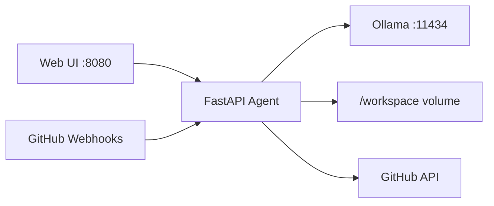

# Ollama Cursor Agent

A **Dockerized, local coding agent** inspired by [Cursor Cloud Agents](https://cursor.com/docs/cloud-agent): chat-driven tasks, multi-step tool use (read/write files, search, shell), and a web UI — backed entirely by **[Ollama](https://ollama.com)** on your machine.

No cloud LLM API keys required.

## Architecture



| Component | Role |
|-----------|------|
| `ollama` | Runs local models (Llama, Qwen Coder, etc.) |
| `agent` | Agent loop, tools, REST + SSE API, static UI |
| `/workspace` | Your repo — the agent can only touch files under this mount |

## Quick start

```bash
cd ollama-agent
cp .env.example .env   # optional tweaks

docker compose up -d --build

# Pull a coding model (first time)
docker exec ollama ollama pull qwen2.5-coder:7b
```

Open **http://localhost:8080**, pick the model, and describe a task (e.g. “Add a health check script and run it”).

### Point the agent at your project

By default, `docker-compose.yml` mounts the parent directory (`../`) as `/workspace`. Override on the host:

```bash
AGENT_WORKSPACE=/path/to/your/repo docker compose up -d
```

Or edit `.env`:

```env
AGENT_WORKSPACE=/path/to/your/repo
```

## GitHub workflow (like Cursor Cloud Agents)

The agent can **branch, commit, push, open PRs, and comment on issues** — similar to a cloud agent on GitHub — using a **local** Ollama model.

### 1. Configure credentials

In `.env`:

```env
GITHUB_TOKEN=ghp_...          # classic PAT or fine-grained token
GITHUB_REPO=your-user/your-repo
GITHUB_DEFAULT_BRANCH=main
GITHUB_BRANCH_PREFIX=cursor/
GITHUB_BRANCH_SUFFIX=local
```

Token scopes: **repo** (or fine-grained: contents, pull requests, issues — read/write).

Mount a **clone** of that repo at `AGENT_WORKSPACE` (or use `../` if compose lives inside the repo).

### 2. Run from the UI

Open the **GitHub** section in the sidebar → **Load open issues** → **Run** on an issue.  
The agent will:

1. Comment on the issue that it started  
2. Create `cursor/<slug>-local` (configurable)  
3. Implement, test, commit, push  
4. Open a PR and post a summary comment  

### 3. Trigger from GitHub (webhooks)

Expose port `8080` (or set `PUBLIC_BASE_URL` for docs). Add a webhook on the repo:

| Setting | Value |
|---------|--------|
| Payload URL | `https://<your-host>/api/github/webhook` |
| Secret | same as `GITHUB_WEBHOOK_SECRET` |
| Events | **Issues**, **Issue comments** |

Triggers:

- Add label **`agent`** to an issue (default; change with `GITHUB_TRIGGER_LABEL`)
- Comment **`@agent`** on an issue (`GITHUB_COMMENT_TRIGGER`)

### 4. API

```bash
curl -s http://localhost:8080/api/github/run-issue \
  -H 'Content-Type: application/json' \
  -d '{"issue_number": 42}'
```

```bash
curl -s http://localhost:8080/api/github/jobs
```

### Agent GitHub tools

| Tool | Purpose |
|------|---------|
| `git_checkout_branch` | Feature branch from default branch |
| `git_commit` / `git_push` | Ship changes |
| `github_create_pull_request` | Open PR |
| `github_get_issue` / `github_post_comment` | Read context, notify humans |

## Recommended models

Tool calling works best with recent Ollama builds and models that support function tools, for example:

- `qwen2.5-coder:7b` (default — good balance of size and coding)
- `qwen2.5-coder:14b`
- `llama3.1:8b`
- `deepseek-coder-v2:16b`

Pull from the UI sidebar or:

```bash
docker exec ollama ollama pull qwen2.5-coder:7b
```

## GPU (optional)

Uncomment the NVIDIA `deploy` section under `ollama` in `docker-compose.yml`, install the [NVIDIA Container Toolkit](https://docs.nvidia.com/datacenter/cloud-native/container-toolkit/install-guide.html), then recreate the stack.

## API

| Endpoint | Description |
|----------|-------------|
| `GET /api/health` | Ollama connectivity |
| `GET /api/models` | Installed models |
| `POST /api/chat` | Run one agent turn (JSON) |
| `POST /api/chat/stream` | Same, with Server-Sent Events |
| `GET /api/sessions/{id}` | Session history + tool events |

Example:

```bash
curl -s http://localhost:8080/api/chat \
  -H 'Content-Type: application/json' \
  -d '{"message":"List top-level files and summarize the README"}'
```

## Tools (agent capabilities)

Similar to a slim Cursor agent toolchain:

- `list_directory` — explore the repo
- `read_file` / `write_file` — view and edit sources
- `search_files` / `glob_files` — ripgrep-style search and globs
- `run_shell` — tests, builds, git (timeouts enforced; cwd is `/workspace`)

Paths are sandboxed: the agent cannot escape the workspace mount.

## Configuration

Environment variables (set on the `agent` service):

| Variable | Default | Meaning |
|----------|---------|---------|
| `AGENT_OLLAMA_BASE_URL` | `http://ollama:11434` | Ollama API |
| `AGENT_DEFAULT_MODEL` | `qwen2.5-coder:7b` | Default model name |
| `AGENT_WORKSPACE_ROOT` | `/workspace` | In-container workspace root |
| `AGENT_MAX_AGENT_STEPS` | `40` | Max LLM/tool iterations per message |
| `AGENT_SHELL_TIMEOUT_SEC` | `120` | Shell command timeout |

## Development (without Docker)

```bash
cd agent
pip install -r requirements.txt
export AGENT_OLLAMA_BASE_URL=http://127.0.0.1:11434
export AGENT_WORKSPACE_ROOT=/workspace
uvicorn app.main:app --reload --port 8080
```

Run Ollama on the host separately.

## License

MIT — use and modify freely.
